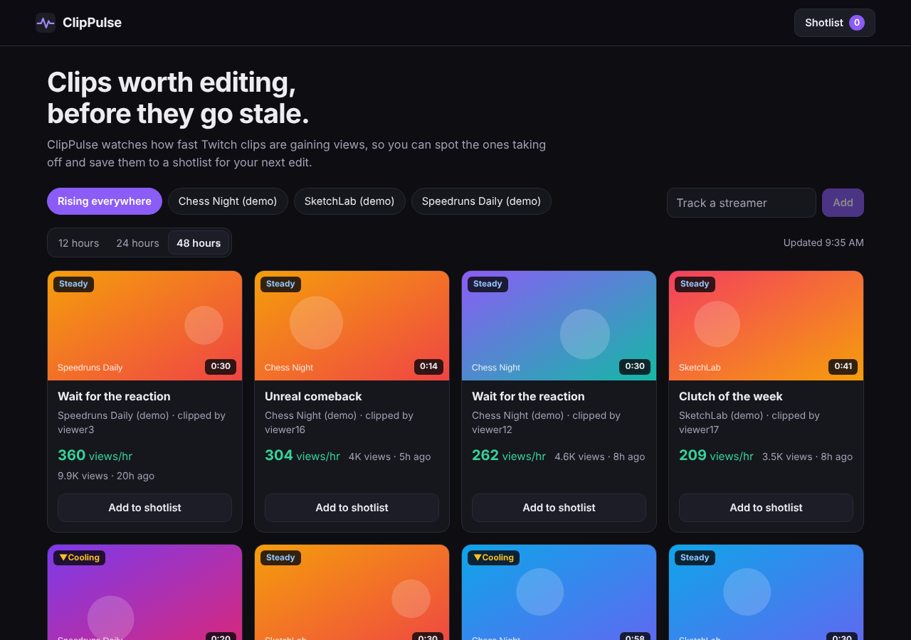

# ClipPulse


Find Twitch clips that are **rising right now**, before they go stale, and save the best ones to a shotlist for your next edit.

Video editors and clip channels lose the window on a good moment: by the time a clip has big numbers, everyone has already cut it. ClipPulse watches how fast clips gain views, hour by hour, and ranks them by momentum instead of by total views.



## What it does

- **Rising feed.** Clips from the streamers you track, ranked by views gained per hour, with a Surging / Steady / Cooling badge.
- **Watch and chart.** Click a thumbnail to play the clip in the page (Twitch's official embed, loaded only after you click), with a growth chart of its views over time. Cards show a small version of the same chart.
- **Per-streamer view.** Sort by momentum, total views or newest, over the last 24 hours, 3 days or 7 days.
- **Shotlist.** Save clips, jot a note on how you would cut each one (the VOD timestamp is shown so you can find the moment in the full stream), and export everything as a CSV.
- **No accounts.** A shotlist is identified by a random, unguessable id kept in your browser. Share the link to share the list.

## How "rising" is calculated

Two numbers, both in views per hour (`backend/src/clippulse/scoring.py`):

| Number | Definition | Why |
| --- | --- | --- |
| Average velocity | `views / (age + 2h)` | The 2 hour prior stops a three-minute-old clip with 4 views from outranking a day-old clip with 900. |
| Recent velocity | Views gained between our own hourly snapshots over the last 6 hours | This is the "taking off right now" signal. Needs at least two snapshots, and is ignored if the data is more than 3 hours stale. |

Clips are ranked by recent velocity when it exists, otherwise by average velocity. Ties break on total views, then clip id, so results are deterministic.

Twitch returns clips most-viewed first, and the poller reads one page. To make sure brand-new clips are never crowded out by older hits on a busy channel, each poll makes a second short-window query (last 6 hours) and merges the two.

## Architecture

```
                       Browser (React)
                             |
                        API Gateway (HTTP API, throttled)
                             |
                   Lambda: api  (/api/* = JSON API, everything else = the built React site)
                             |
   EventBridge (hourly) --> Lambda: poller --> Twitch Helix API
                             |                      |
                             +----> DynamoDB (single table, TTL)
                             SSM Parameter Store: Twitch credentials
```

Optional: set `EnableCloudFront=true` to put CloudFront + a private S3 bucket in front for the site (needs a CloudFront-verified AWS account).

- **Backend:** Python 3.13 on Lambda (arm64) with **zero third-party dependencies**: `urllib` for Twitch, `boto3` from the runtime. Nothing to package, nothing to patch.
- **Data:** one DynamoDB table in on-demand mode. Clips expire through TTL.
- **Frontend:** React 19, plain CSS, bundled with esbuild into a static site (about 65 KB gzipped).
- **Same origin:** the API Lambda serves both `/api/*` and the site (gzip, long-cache hashed assets, strict CSP and security headers), so the browser never makes a cross-origin call and there is no CORS configuration. CloudFront is optional.
- **Infrastructure as code:** one AWS SAM template (`template.yaml`) creates everything, including a security-headers policy with a strict Content Security Policy and an optional AWS Budgets alert.

### DynamoDB single-table layout

| pk | sk | holds |
| --- | --- | --- |
| `STREAMERS` | `S#<login>` | a tracked streamer |
| `B#<broadcaster_id>` | `C#<created_at>#<clip_id>` | a clip, its latest views and a capped `history` list of `[timestamp, views]` |
| `BOARD#<board_id>` | `I#<clip_id>` | one saved shotlist item |

A streamer's recent clips come back from one `Query` on the sort-key range, so the feed needs no scans and no secondary indexes.

## Run it on your laptop (no AWS, no Twitch keys)

```bash
cd frontend && npm install && npm run build && cd ..
python3 backend/dev_server.py          # open http://localhost:8787
```

This runs the real API code against an in-memory store and a **demo** Twitch with made-up channels. It pretends the poller has run for six hours so trends have something to show, and it ticks forward every 20 seconds so you can watch numbers move.

For frontend work, run `npm run watch` in `frontend/` next to the dev server.

## Tests

```bash
cd backend && python3 -m pytest -q     # 183 tests, standard library + pytest only
cd frontend && npm test                # 19 tests with Node's built-in runner
python3 scripts/check_template.py template.yaml
node scripts/e2e_check.js              # drives the real UI in Chromium against the demo server
```

What the backend suite covers: the ranking math (windows, staleness, tie-breaks), the Twitch client (token reuse and refresh, one retry on 401, rate limits, pagination, with an injected HTTP function), every store behavior as a **contract test that runs against both the in-memory store and the DynamoDB store** (history capping, key layout, floats and Decimals, paginated queries), the service rules (limits, validation, idempotency, CSV formula-injection protection), and every API route including error paths.

The DynamoDB store is exercised against a small in-process fake of boto3's `Table` API that rejects floats and paginates like the real service. To run the same suite against a real DynamoDB engine:

```bash
docker run -p 8000:8000 amazon/dynamodb-local
pip install boto3
CLIPPULSE_TEST_ENDPOINT=http://localhost:8000 python3 -m pytest -q
```

CI (`.github/workflows/ci.yml`) does exactly that with DynamoDB Local as a service container, then builds the frontend, lints the template and runs the browser check.

## Deploy to AWS

You need an AWS account, the [AWS CLI](https://aws.amazon.com/cli/) and the [SAM CLI](https://docs.aws.amazon.com/serverless-application-model/latest/developerguide/install-sam-cli.html). Use an IAM Identity Center user or an IAM user with limited permissions, never the root account's keys.

**1. Register a Twitch app** at <https://dev.twitch.tv/console/apps> (client type: Confidential, any redirect URL such as `http://localhost`). Copy the Client ID and generate a Client Secret.

**2. Store the credentials in SSM Parameter Store.** The secret is encrypted with the AWS-managed key.

```bash
aws ssm put-parameter --name /clippulse/twitch_client_id     --type String       --value "YOUR_CLIENT_ID"
aws ssm put-parameter --name /clippulse/twitch_client_secret --type SecureString --value "YOUR_CLIENT_SECRET"
```

**3. Build and deploy.** One script builds the React app, bundles it into the Lambda, and runs SAM. Pass your email so AWS Budgets warns you at 80 percent of a monthly budget (default 5 USD).

```bash
scripts/deploy.sh --guided     # first time: stack name clippulse, set AlertEmail when prompted
scripts/deploy.sh              # later deploys reuse the saved answers
```

The last lines print `SiteUrl`. Open it.

> New AWS accounts can be blocked from creating CloudFront distributions until AWS Support verifies the account ("Your account must be verified before you can add new CloudFront resources"). That is why CloudFront is off by default. Once verified, redeploy with `--parameter-overrides EnableCloudFront=true`, then sync `frontend/dist` to `SiteBucketName` and invalidate the distribution.

**4. Add a streamer and take the first snapshot.** Use the box on the site, then trigger the poller by hand so you don't wait an hour. Velocity badges appear once a clip has two snapshots.

```bash
aws lambda invoke --function-name "$(aws cloudformation describe-stacks --stack-name clippulse --query "Stacks[0].Outputs[?OutputKey=='PollerFunctionName'].OutputValue" --output text)" /dev/stdout
```

**Tear it all down:**

```bash
sam delete --stack-name clippulse       # if CloudFront was enabled, empty the site bucket first
```

### Cost

Everything is pay-per-use. At the default limits (10 streamers, top 100 clips each, one poll per hour) the poller does on the order of a thousand DynamoDB writes an hour, which on-demand pricing turns into pennies to low single dollars a month, and Lambda, API Gateway and CloudFront at portfolio traffic add little. Check current pricing for your region, and keep the `AlertEmail` budget set.

## Design decisions and trade-offs

- **History as a list on the clip item, not one item per snapshot.** One `Query` returns a streamer's clips with their trends, and each poll costs one read and one write per clip. The cost is a read-modify-write per clip, which is safe because a single scheduled poller writes them.
- **DynamoDB over Postgres.** Access patterns are fixed and key-based, there are no joins, and TTL cleans up old clips for free. A relational store would add a VPC or a connection pooler to a function that runs for seconds.
- **Lambda over containers.** Traffic is bursty and tiny, and the hourly poller finishes in seconds.
- **`urllib` instead of `requests`.** No packaging step and no dependency to patch for a handful of JSON calls. The HTTP function is injected, which is also what makes the Twitch client unit-testable without a network.
- **Lambda serves the site by default.** One origin means no CORS and one CSP everywhere, and it deploys on any account. The cost is that each page load invokes a function (the bundle is cached in memory and hashed assets are cached by browsers for a year); CloudFront + S3 is the better choice at real traffic, so it stays available behind a flag.
- **Capability-URL shotlists instead of accounts.** The 128-bit random board id is the key. That keeps the app login-free, at the cost that the link must be treated like a password. Cognito would be the next step if shotlists ever hold anything sensitive.
- **Server looks up the clip.** Saving a clip sends only a clip id and streamer. The server copies the title and URL from its own data, so a caller cannot store arbitrary links or text in someone's shotlist.
- **CSV export neutralises formulas.** Clip titles are written by strangers, so cells starting with `=`, `+`, `-` or `@` are prefixed with an apostrophe before they reach a spreadsheet.

## Known limits

- **The streamer list is public.** Anyone can add a streamer, up to the cap (`MaxStreamers`, default 10). That bounds cost and Twitch usage, but a visitor could fill the slots. Fine for a portfolio project; add an admin token or authentication before running it for real users. Remove a streamer with `aws dynamodb delete-item`.
- **Velocity needs history.** A clip shows its average velocity until it has two snapshots at least 30 minutes apart, so a freshly added streamer looks less sharp for the first hour or two.
- **Hourly resolution.** The poll interval is a template parameter (`PollSchedule`); polling faster costs proportionally more Twitch calls and writes.
- **Twitch's data, Twitch's limits.** Only clips Twitch's API returns are visible, with the view counts it reports. ClipPulse is an independent project, not affiliated with or endorsed by Twitch.

## Project layout

```
template.yaml                 SAM template: everything in AWS
backend/src/clippulse/        scoring, twitch client, store, service, api, static site, poller
backend/tests/                183 tests plus fakes
backend/dev_server.py         local demo with fake channels
frontend/src/                 React app (components, hooks, API client, pure helpers)
frontend/test/                logic tests
scripts/                      deploy.sh, template checker, browser end-to-end check
.github/workflows/ci.yml      CI
```
